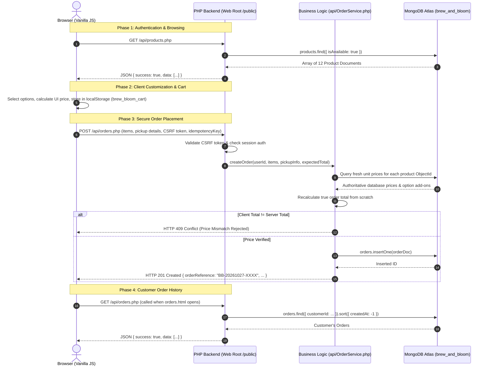

# Brew & Bloom — Presentation Guide & Viva Notes
**Coursework:** ICT 3131 Web Technologies (5-Mark Undergraduate Laboratory Project)  
**Date of Presentation:** 28 October 2026  
**Tech Stack:** HTML5, Vanilla CSS3, Vanilla JavaScript (ES6+), PHP 8.2+, MongoDB Atlas, Composer (`mongodb/mongodb`, `vlucas/phpdotenv`).

---

## 1. Project Introduction (2–3 Sentences)

> **Brew & Bloom** is a full-stack smart café ordering web application built for an artisanal coffee roastery and bakehouse in Indiranagar, Bengaluru. It features a responsive, accessible frontend crafted in semantic HTML5, vanilla CSS3, and modern JavaScript, coupled with a server-authoritative PHP backend and a cloud-hosted MongoDB Atlas database. The application securely handles customer authentication, dynamic catalog exploration, client-side product customization, shopping cart persistence, and order placement with tamper-proof server-side price recalculation.

---

## 2. 4-Minute Live Demonstration Script

| Timestamp | Screen / Page | Presenter | Action & Key Talking Points |
| :--- | :--- | :--- | :--- |
| **0:00 – 0:40** | `index.html` & `register.html` | **Presenter 1** | Show the warm cream & espresso design system. Highlight semantic HTML (`<header>`, `<nav>`, `<main>`, `<footer>`), 16px body typography, and WCAG AA contrast. Navigate to `/register.html`, demonstrate form validation (missing field error), then register a new demo customer. |
| **0:40 – 1:20** | `account.html` & `menu.html` | **Presenter 1** | Show the success alert and automatic sign-in (PHP sets `$_SESSION` on registration and redirects to `/account.html`). Point out the navbar dynamically updating to display `My Orders` and `Account (Name)`. Open `/menu.html`, explain that all 12 café items are fetched asynchronously via Fetch API from MongoDB. Demonstrate real-time category filtering (Coffee / Tea / Bakery) and instant keyword search. |
| **1:20 – 2:20** | `menu.html` (Modal) & `cart.html` | **Presenter 2** | Click **"Customize & Add"** on a beverage (e.g. Hazelnut Latte). Show dynamic radio buttons and checkboxes (size, milk choice, sweetness, extras). Explain client-side live pricing math. Add to cart and observe the animated cart counter badge updating. Navigate to `/cart.html`, demonstrate quantity updates (+/-) and line total recalculation, explaining `localStorage` (`brew_bloom_cart`) persistence across browser page refreshes. |
| **2:20 – 3:20** | `checkout.html` | **Presenter 2** | Click **"Proceed to Checkout"**. Show the accessible two-column layout and pre-filled customer details. Explain that prices shown are verified against a pre-flight quote (`/api/orders.php?action=quote`), preventing client-side price tampering. Select pickup time and submit. Point out the Order Confirmation Modal with the generated reference code (`BB-20261027-XXXX`). |
| **3:20 – 4:00** | `orders.html` & MongoDB Atlas | **Both** | Click **"View My Orders"**. Display the newly placed order in the customer's history with timestamps, itemized customization pills, and the 4-stage preparation status stepper (`Order Placed` &rarr; `Preparing` &rarr; `Ready at Counter` &rarr; `Completed`). Switch to MongoDB Atlas in the browser to show the inserted order document in the `orders` collection. |

---

## 3. Implemented Functionalities & Web Technology Concepts

### 1. Customer Registration, Login & Authentication
- **HTML5:** Semantic forms with `<fieldset>`, `<legend>`, `<label for="...">`, required field indicators (`aria-required="true"`), and accessible inline error spans (`role="alert"`).
- **CSS3:** Clean floating inputs, focus outlines with visible high contrast (`:focus-visible`), and responsive single-column layouts on mobile.
- **JavaScript:** Client-side validation before submission, Fetch API requests with `credentials: 'same-origin'`, and CSRF token header attachment (`X-CSRF-Token`).
- **PHP:** `AuthService.php` using native PHP sessions, `password_hash($pwd, PASSWORD_DEFAULT)` using Bcrypt, session fixation defense via `session_regenerate_id(true)`, and role-based access control (`customer` vs `admin`). Registration automatically establishes an active customer session.
- **MongoDB:** Queries the `users` collection using unique email indexing; stores sanitized customer profiles.

### 2. Dynamic MongoDB Menu, Search & Category Filtering
- **HTML5:** Semantic product card `<article class="product-card">` with lazy-loaded `` elements and explicit `alt` text.
- **CSS3:** Responsive CSS Grid (`grid-template-columns: repeat(auto-fill, minmax(280px, 1fr))`) and smooth filter badge transitions.
- **JavaScript:** `menu.js` fetches catalog items from `api/products.php`, caches them in memory, and performs instant client-side filtering without reloading the page.
- **PHP:** `ProductService.php` queries MongoDB collection `products` using `$filter` arrays and projection options.
- **MongoDB:** Stores 12 distinct café items across `coffee`, `tea`, and `bakery` categories with flexible nested options.

### 3. Product Customization & Dynamic Price Calculation
- **HTML5:** Accessible modal dialog (`role="dialog"`, `aria-modal="true"`) with keyboard trap (`Escape` key closes modal).
- **CSS3:** Fixed backdrop with blur filter (`backdrop-filter: blur(4px)`) and responsive radio/checkbox pill buttons.
- **JavaScript:** `customizer.js` computes formula:  
  $$\text{Unit Price} = \text{Base Price} + \Delta\text{Size} + \Delta\text{Milk} + \sum \Delta\text{Extras}$$  
  Generates a deterministic hash representing the exact combination to group identical customized items in the cart.

### 4. Shopping Cart & LocalStorage Persistence
- **HTML5:** Semantic table/list structure displaying item thumbnails, customization tags, quantity controls, and remove triggers.
- **CSS3:** Sticky order summary card (`position: sticky; top: 100px;`) and responsive mobile breakdown.
- **JavaScript:** `cart.js` encapsulates cart state via an IIFE module pattern; synchronizes all mutations directly to browser `localStorage` under key `brew_bloom_cart`. Dispatches the custom event `cart:updated` to update the navbar badge.

### 5. Secure Checkout & Server-Authoritative Pricing
- **HTML5:** Two-column checkout layout with semantic `<fieldset>` groups (`Contact Information`, `Pickup Details`, `Payment Method`).
- **CSS3:** Visual form validation states (`.has-error`) and accessible error containers.
- **JavaScript:** `checkout.js` generates a unique UUID-based idempotency key per checkout attempt, pre-validates inputs, and submits an authoritative quote pre-flight.
- **PHP:** `OrderService.php` **recalculates every line item price from scratch** against the MongoDB database prices before writing to the database. If a user maliciously alters client-side totals in DevTools, the server rejects tampered totals with HTTP 409 Conflict.
- **MongoDB:** Inserts complete, immutable order documents into `orders` with unique reference codes, customer ID, items snapshot, and idempotency key.

### 6. Customer Order History & Progress Stepper
- **HTML5:** Structured order cards `<article class="order-card">` with timestamp headers, itemized breakdown tables, and pickup summaries.
- **CSS3:** Multi-step horizontal progress stepper (`.order-stepper`) with active and completed circle indicators.
- **JavaScript:** `orders.js` requests customer-specific orders on page load via `fetch('api/orders.php')` and dynamically renders cards, highlighting newly placed orders via query parameters (`?highlight=BB-...`).
- **PHP:** Authenticates the session customer and queries `['customerId' => $sessionUserId]` with sorting `['createdAt' => -1]`, guaranteeing strict cross-account tenant isolation.

---

## 4. Suggested Team Demonstration Split

| Role | Team Member | Features Covered | Live Action to Perform |
| :--- | :--- | :--- | :--- |
| **Speaker 1** | Member 1 | **Features 1 & 2**<br>• Authentication & RBAC<br>• Dynamic Menu & Search | 1. Walk through homepage branding and responsive navigation.<br>2. Demonstrate customer registration (show validation error, then register demo user).<br>3. Show automatic login redirect to `account.html` and dynamic navbar state.<br>4. Open dynamic menu, search for "Croissant", and filter by "Bakery". |
| **Speaker 2** | Member 2 | **Features 3, 4, 5 & 6**<br>• Customization & Cart<br>• Checkout & Server Pricing<br>• Order History & MongoDB | 1. Customize Hazelnut Latte with Oat Milk & Extra Shot; add to cart.<br>2. Open `/cart.html`, change quantity, demonstrate subtotal calculation.<br>3. Proceed to checkout, complete pickup form, and place order.<br>4. Show confirmed order in `/orders.html` and show document in MongoDB Atlas. |

---

## 5. Architectural Data Flow



---

## 6. Ten Likely Viva Questions & Source-Code Answers

#### Q1: Why did you not use a frontend framework like React or Tailwind?
> **Answer:** The assignment requirements specified pure web technologies (HTML5, CSS3, vanilla JavaScript). Building without third-party frameworks demonstrates our understanding of fundamental DOM manipulation, CSS Grid and Flexbox layouts, custom events, and the browser Fetch API without relying on external libraries or build tools.

#### Q2: How is client-side state preserved across page reloads in the shopping cart?
> **Answer:** We built a dedicated module in `public/js/cart.js` that serializes the cart items array into JSON and stores it in the browser's `localStorage` under the key `brew_bloom_cart`. On page load, `getItems()` deserializes this data. Cart modifications trigger a custom `cart:updated` event, which updates the navigation cart badge and synchronizes page views.

#### Q3: How do you prevent a malicious customer from changing product prices in DevTools before ordering?
> **Answer:** We implement **Server-Authoritative Pricing** in `api/OrderService.php`. When an order is submitted to `/api/orders.php`, the server ignores any client-calculated prices. It queries the MongoDB database for each item's base price and option modifiers, recalculates the entire total on the backend, and compares it to the client's `expected_total`. If they do not match, the request is rejected with HTTP 409 Conflict.

#### Q4: How is authentication state maintained between the frontend and backend?
> **Answer:** We use native PHP session handling (`session_start()`). Upon registration or successful login with `password_verify()`, the user's ID, name, email, and role are saved into the server-side `$_SESSION` superglobal, and a session cookie (`PHPSESSID`) is stored by the browser. Subsequent Fetch API requests automatically send this cookie using `credentials: 'same-origin'`.

#### Q5: How do you protect your application against Cross-Site Request Forgery (CSRF)?
> **Answer:** On session creation, `api/AuthService.php` generates a cryptographically secure 64-character token via `bin2hex(random_bytes(32))` and stores it in `$_SESSION['csrf_token']`. The frontend fetches this token from `/api/auth/csrf.php` and passes it in the `X-CSRF-Token` header on modifying requests (POST). The backend validates it using `hash_equals()`, which guards against timing attacks.

#### Q6: How does the application handle duplicate order submissions if a user double-clicks "Place Order"?
> **Answer:** In `public/js/checkout.js`, a unique UUID idempotency key is generated per checkout session and sent in the order payload. In `api/OrderService.php`, the server checks whether an order with the same `customerId` and `idempotencyKey` already exists in MongoDB (enforced by a compound unique index). If an identical key is received, it returns the existing order rather than creating a duplicate.

#### Q7: How does your database schema reflect the flexibility of MongoDB?
> **Answer:** Unlike relational databases that require multiple join tables (such as `order_items` and `item_customizations`), MongoDB allows us to embed a complete snapshot of customized options (size, milk type, sweetness, extras) directly inside each order's `items` array. This ensures that past orders remain historically accurate even if catalog items or prices change later.

#### Q8: How did you ensure accessibility (a11y) and WCAG compliance?
> **Answer:** 
> 1. Form inputs have explicitly paired `<label for="...">` attributes and required indicators.
> 2. High-contrast colors meet WCAG AA standards (espresso brown `#2C1810` on cream background `#FAF7F2` gives a contrast ratio > 10:1).
> 3. Interactive components feature visible keyboard focus states (`:focus-visible` with a 2px caramel outline).
> 4. Asynchronous updates are announced to screen readers using ARIA live regions (`aria-live="polite"`).
> 5. Base typography maintains a minimum of 16px body font size.

#### Q9: What happens if an unauthenticated user tries to checkout or view orders?
> **Answer:** Both client-side and server-side guards are in place. On the frontend, `checkout.js` and `orders.js` check `window.BrewAuth.getCurrentUser()`; if unauthenticated, they redirect to `login.html` with a return parameter. On the backend, `/api/orders.php` checks `$_SESSION['user_id']` and returns HTTP 401 Unauthorized (`{"success": false, "message": "Authentication required"}`) if absent.

#### Q10: How are passwords stored securely in MongoDB?
> **Answer:** Passwords are never stored in plain text. In `api/AuthService.php`, passwords are processed with PHP's `password_hash($password, PASSWORD_DEFAULT)`, which uses the one-way Bcrypt algorithm with automatic salting and a secure work factor. Verification is performed using `password_verify()`.

---

## 7. Exact PowerShell Commands to Run the Application

Open **PowerShell** in `D:\Projects\Brew&Bloom`:

### Step 1: Start the Local PHP Web Server
```powershell
# Run PHP server with /public as the document web root
& C:\php\php.exe -S 127.0.0.1:8000 -t public
```

### Step 2: Open the Website in Your Browser
```text
http://127.0.0.1:8000
```

### Step 3: Seed / Reset Database (If Needed)
```powershell
# Seeds 12 products and default admin/customer accounts into MongoDB Atlas
& C:\php\php.exe database/seed.php
```

---

## 8. Presentation Fallback / Emergency Procedure

Because the café menu and orders rely on MongoDB Atlas in the cloud, ensure your laptop is connected to an active internet connection (such as a smartphone Wi-Fi hotspot) prior to the presentation:

1. **Pre-Load Browser Tabs:** Open `index.html`, `menu.html`, `cart.html`, and `orders.html` in your browser beforehand so that page assets and initial data are already rendered.
2. **Pre-Loaded Cart Demonstration:** If items have already been added to the cart, the shopping cart page (`cart.html`) reads directly from `localStorage` (`brew_bloom_cart`), allowing you to demonstrate quantity changes (+/-), line total calculations, and cart badge updates even if internet connectivity momentarily lags.
3. **Smartphone Hotspot Backup:** Campus Wi-Fi networks sometimes restrict outbound connections on MongoDB's default port (`27017`). Keep a smartphone hotspot active as an immediate alternative network.
4. **Code Architecture Walkthrough:** If internet connectivity is completely lost, open VS Code to walk examiners directly through the code architecture:
   - `api/OrderService.php`: Explain server-authoritative price recalculation and idempotency handling.
   - `public/js/cart.js`: Show the `localStorage` engine and `cart:updated` event dispatch.
   - `public/js/checkout.js`: Show CSRF header attachment and input validation logic.

---

## 9. Final Pre-Presentation Verification Matrix

| Req # | Requirement Description | Verification Method | Status |
| :---: | :--- | :--- | :--- |
| **1** | Customer Registration with validation & Bcrypt hashing | Browser subagent + Python test suite | **PASS** |
| **2** | Customer Login, Session Persistence & RBAC guards | Browser subagent + Python test suite | **PASS** |
| **3** | Dynamic Menu (12 items) fetched from MongoDB Atlas | Browser inspection + JSON API check | **PASS** |
| **4** | Real-time Menu Search & Category Filtering | Browser DOM interaction | **PASS** |
| **5** | Product Customization Modal with live price calculation | Browser modal + JS price engine | **PASS** |
| **6** | Shopping Cart with quantity adjustments & localStorage | Browser inspection + unit calculations | **PASS** |
| **7** | Server-Authoritative Price Quote & Tamper Prevention | Automated test suite (HTTP 409 test) | **PASS** |
| **8** | Order Placement with CSRF & Idempotency in MongoDB | Automated test suite (HTTP 201 test) | **PASS** |
| **9** | Order Confirmation Modal with generated Order Ref | Visual confirmation + UI inspection | **PASS** |
| **10** | Customer Order History with 4-stage stepper | Visual browser audit + isolation test | **PASS** |
| **11** | Semantic HTML5 & Validated Heading Hierarchy | Static markup audit on all 9 pages | **PASS** |
| **12** | Responsive Layout (Desktop 1280px & Mobile 420px) | Browser viewport resize audit | **PASS** |
| **13** | WCAG AA Contrast, Focus Indicators & Min 16px Body | CSS stylesheet audit (`style.css`) | **PASS** |
| **14** | Zero committed credentials or `.env` secrets | `git status --ignored` check | **PASS** |
| **15** | PHP Syntax and Runtime Integrity across all endpoints | `php -l` on all 15 PHP files | **PASS** |
